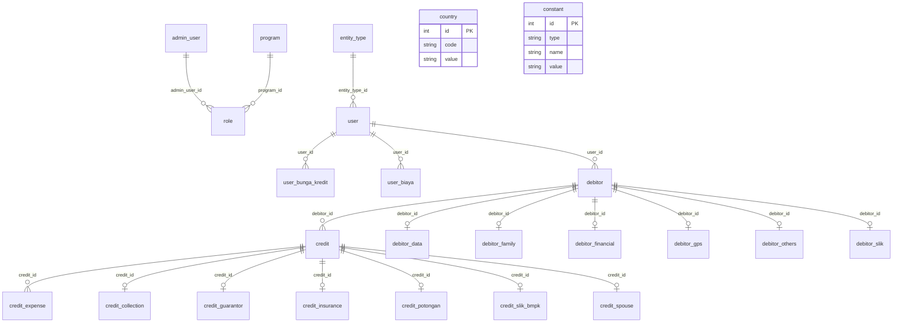

# Model data credit-system

Spesifikasi awal 24 entitas MySQL. Nama kolom dan tipe di bawah adalah acuan model; skema fisik, nullable, default, ukuran, index, FK dan isi database belum diverifikasi. Tidak mengasumsikan bahwa relasi konseptual otomatis menjadi constraint.

## Kolom umum

- Semua entitas: `id` bertipe `INTEGER.UNSIGNED` sebagai primary key; `created_at` dan `updated_at` bertipe `DATE`.
- `created_by` dan `updated_by` bertipe `STRING`, kecuali pada `entity_type`, `program`, `role`.
- Auto-increment ditentukan untuk id, kecuali `entity_type`, `program`, `role` yang mekanisme id-nya masih perlu diputuskan. Tipe `NUMBER` dalam kamus perlu dipetakan ke tipe MySQL yang tepat.
- Field umum tidak diulang di bawah. Nama bertipe `STRING`/`DOUBLE` adalah bentuk model konseptual, bukan spesifikasi panjang atau presisi DDL.

## Entitas dan kolom

#### `admin_user` — `AdminUser`

Akun administrator internal dan pemilik daftar role.

- `BOOLEAN`: `is_active`.
- `STRING`: `email`, `password`, `username`.

#### `constant` — `Constant`

Kamus opsi konfigurasi dinamis berdasarkan type/name/value.

- `STRING`: `name`, `type`, `value`.

#### `country` — `Country`

Referensi kode/nama negara.

- `STRING`: `code`, `value`.

#### `credit` — `Credit`

Pengajuan kredit, nilai angsuran, rekening tujuan, status persetujuan dan dokumen.

- `DATE`: `debitor_acknowledgment_timestamp`, `tanggal_pengajuan`.
- `DOUBLE`: `biaya_asuransi_jiwa`.
- `INTEGER`: `jangka_waktu_bulan`.
- `INTEGER.UNSIGNED`: `debitor_id`.
- `STRING`: `bank_account_name`, `bank_account_number`, `bank_branch`, `bank_name`, `bunga_angsuran_bulanan`, `doc_url`, `jumlah_angsuran`, `jumlah_pengajuan`, `nilai_angsuran`, `pokok_angsuran`, `status`, `status_admin_approval`.
- `TEXT`: `remarks`.

#### `credit_collection` — `CreditCollection`

Metadata kolektor, marketing, pembayaran dan klasifikasi BI.

- `INTEGER`: `persen_penjamin`.
- `INTEGER.UNSIGNED`: `credit_id`.
- `STRING`: `bi_jenis_penggunaan`, `bi_sifat_pinjaman`, `golongan_debitur`, `jenis_usaha`, `kode_group_4`, `kode_group_5`, `nama_kolektor`, `nama_marketing`, `nama_wilayah`, `periode_pembayaran`, `periode_pembayaran_bunga`, `sandi_penjamin`, `sumber_pelunasan`.

#### `credit_expense` — `CreditExpense`

Snapshot komponen biaya setiap kredit.

- `INTEGER`: `amount`, `value`.
- `INTEGER.UNSIGNED`: `credit_id`.
- `STRING`: `expense_name`, `unit`.

#### `credit_guarantor` — `CreditGuarantor`

Identitas penjamin dan persentase penjaminan.

- `INTEGER`: `persentase_penjamin`.
- `INTEGER.UNSIGNED`: `credit_id`.
- `STRING`: `alamat`, `hubungan`, `kode_golongan_penjamin`, `kode_identitas_penjamin`, `nama`, `no_id`, `npwp`, `pekerjaan`.
- `TEXT`: `keterangan`.

#### `credit_insurance` — `CreditInsurance`

Data pertanggungan/asuransi kredit.

- `DATE`: `tanggal_jt_asuransi`.
- `INTEGER`: `jangka_waktu_asuransi`, `nilai_pertanggungan`.
- `INTEGER.UNSIGNED`: `credit_id`.
- `STRING`: `nama_asuransi`, `status_pertanggungan`.

#### `credit_potongan` — `CreditPotongan`

Rincian potongan, provisi, pajak, biaya dan rekening terkait.

- `DOUBLE`: `denda_tunggakan_persentase`, `lainlain_persentase`, `pajak_transaksi_persentase`, `provisi_persentase`.
- `INTEGER`: `adm_per_bulan`, `biaya_transaksi`, `bpkb`, `fiducia`, `kebakaran`, `kendaraan`, `lainlain_nilai`, `lainnya_1`, `lainnya_2`, `lainnya_3`, `materai`, `notaris`, `pajak_transaksi_nilai`, `potongan_tab`, `premi`, `provisi_nilai`, `tabungan_wajib`.
- `INTEGER.UNSIGNED`: `credit_id`.
- `STRING`: `rek_notaris`, `rek_premi`, `rek_tabungan`, `rek_tabungan_wajib`, `rekening`.

#### `credit_slik_bmpk` — `CreditSlikBmpk`

Klasifikasi kredit untuk data SLIK/BMPK.

- `INTEGER.UNSIGNED`: `credit_id`.
- `STRING`: `akad_pembiayaan`, `cara_restrukturisasi`, `hubungan_keterkaitan`, `jenis_kredit`, `jenis_penggunaan`, `jenis_suku_bunga`, `kategori_debitur`, `kelompok_debitur`, `kode_keterkaitan`, `kode_kondisi`, `kode_program_pemerintah`, `kota_kab_penggunaan`, `no_rekening_slik`, `orientasi_penggunaan`, `penyediaan_dana`, `sandi_bank`, `sebab_macet`, `sektor_ekonomi`, `sifat_kredit`, `sumber_dana`, `valuta`.
- `TEXT`: `keterangan`.

#### `credit_spouse` — `CreditSpouse`

Status persetujuan/data pasangan pada kredit.

- `INTEGER.UNSIGNED`: `credit_id`.
- `STRING`: `status`.

#### `debitor` — `Debitor`

Akun karyawan/nasabah, identitas pribadi, dan perusahaan pemilik.

- `DATE`: `tanggal_lahir`.
- `NUMBER`: `is_berlaku_seumur_hidup`, `is_same_alamat_ktp`, `no_hp`, `no_telp`, `user_id`.
- `STRING`: `agama`, `alamat_domisili`, `alamat_ktp`, `employee_id`, `gelar_depan`, `jenis_kelamin`, `kecamatan`, `kelurahan_desa`, `kewarganegaraan`, `kode_pos`, `kota`, `nama_alias`, `nama_ibu_kandung`, `nama_lengkap`, `no_ktp`, `no_telp_type`, `password`, `pekerjaan`, `pendidikan`, `provinsi`, `status_marital`, `tempat_lahir`, `username`.

#### `debitor_data` — `DebitorData`

URL dokumen identitas, KK, NPWP, selfie, slip gaji dan tanda tangan.

- `INTEGER.UNSIGNED`: `debitor_id`.
- `STRING`: `foto_url`, `kk_url`, `npwp`, `npwp_url`, `selfie_url`, `slip_gaji_url`, `tanda_tangan_url`.

#### `debitor_family` — `DebitorFamily`

Keluarga, pasangan, pernikahan, akta, dan maksimal tiga anak.

- `DATE`: `anak_1_tanggal_lahir`, `anak_2_tanggal_lahir`, `anak_3_tanggal_lahir`, `tanggal_lahir_pasangan`, `tanggal_pernikahan`.
- `INTEGER.UNSIGNED`: `debitor_id`.
- `STRING`: `anak_1_nama`, `anak_2_nama`, `anak_3_nama`, `hobi`, `nama_pasangan`, `no_akta`, `no_id_pasangan`, `no_kk`, `tipe_akta`.

#### `debitor_financial` — `DebitorFinancial`

Pendapatan, pengeluaran, potongan, rekening dan sumber/tujuan dana.

- `BIGINT.UNSIGNED`: `pengeluaran_per_bulan`, `penghasilan_utama_per_tahun`, `potongan_per_bulan`.
- `INTEGER.UNSIGNED`: `debitor_id`, `frek_trans_pemasukan`, `frek_trans_pengeluaran`, `takehome_pay`.
- `STRING`: `no_rekening_bank`, `pemasukan_per_bulan`, `sumber_dana`, `sumber_penghasilan`, `tujuan_pembukaan_rek_tab`, `tujuan_penggunaan_dana`.

#### `debitor_gps` — `DebitorGps`

Koordinat debitor.

- `DOUBLE.UNSIGNED`: `latitude`, `longitude`.
- `INTEGER.UNSIGNED`: `debitor_id`.

#### `debitor_others` — `DebitorOthers`

Pekerjaan, kantor, korespondensi dan metadata debitor lainnya.

- `INTEGER.UNSIGNED`: `debitor_id`, `negara_domisili_id`.
- `STRING`: `alamat_kerja`, `alamat_surat`, `bidang_usaha_tempat_kerja`, `email`, `golongan_debitur`, `hubungan_debitur_dengan_bank`, `jabatan`, `keterangan`, `kota_kab_usaha`, `nama_divisi`, `nama_kantor`, `nama_nasabah_sid`, `no_telp_kantor`, `pangsa_pemilikan`, `pekerjaan`, `perusahaan_tempat_kerja`.
- `TINYINT.UNSIGNED`: `melampaui_bmpk`, `melanggar_bmpk`.

#### `debitor_slik` — `DebitorSlik`

Klasifikasi identitas debitor untuk SLIK.

- `INTEGER.UNSIGNED`: `debitor_id`.
- `STRING`: `badan_usaha`, `bidang_usaha`, `gelar`, `golongan_debitur`, `hubungan_ljk`, `lembaga_pemeringkat`, `negara_id`, `pekerjaan`, `sumber_penghasilan`.

#### `entity_type` — `EntityType`

Referensi jenis entitas perusahaan.

- `STRING`: `value`.

#### `program` — `Program`

Referensi modul/program untuk pengelompokan hak akses.

- `STRING`: `abbreviation`, `name`.

#### `role` — `Role`

Baris izin program milik administrator.

- `INTEGER.UNSIGNED`: `admin_user_id`, `program_id`.
- `STRING`: `value`.

#### `user` — `User`

Perusahaan/mitra dan akun administrator perusahaan, bukan akun debitor.

- `INTEGER.UNSIGNED`: `entity_type_id`.
- `STRING`: `company_name`, `email`, `password`, `slug`, `status`, `username`.

#### `user_biaya` — `UserBiaya`

Konfigurasi biaya perusahaan yang dipakai saat persetujuan kredit.

- `INTEGER`: `value`.
- `INTEGER.UNSIGNED`: `user_id`.
- `STRING`: `expense_type`, `type`.

#### `user_bunga_kredit` — `UserBungaKredit`

Konfigurasi bunga berdasarkan tenor per perusahaan.

- `INTEGER.UNSIGNED`: `user_id`.
- `STRING`: `bunga_percentage`, `jangka_waktu_bulan`.

## Relasi konseptual

Kardinalitas menunjukkan kebutuhan model. Nullability, keunikan dan enforcement FK memerlukan verifikasi sebelum menjadi constraint database.

| Induk → anak | Kardinalitas | FK anak → PK induk |
| --- | --- | --- |
| `admin_user` → `role` | 1 → N | `role.admin_user_id` → `admin_user.id` |
| `program` → `role` | 1 → N | `role.program_id` → `program.id` |
| `entity_type` → `user` | 1 → N | `user.entity_type_id` → `entity_type.id` |
| `user` → `user_bunga_kredit` | 1 → N | `user_bunga_kredit.user_id` → `user.id` |
| `user` → `user_biaya` | 1 → N | `user_biaya.user_id` → `user.id` |
| `user` → `debitor` | 1 → N | `debitor.user_id` → `user.id` |
| `debitor` → `credit` | 1 → N | `credit.debitor_id` → `debitor.id` |
| `debitor` → `debitor_data` | 1 → 0..1 | `debitor_data.debitor_id` → `debitor.id` |
| `debitor` → `debitor_family` | 1 → 0..1 | `debitor_family.debitor_id` → `debitor.id` |
| `debitor` → `debitor_financial` | 1 → 0..1 | `debitor_financial.debitor_id` → `debitor.id` |
| `debitor` → `debitor_gps` | 1 → 0..1 | `debitor_gps.debitor_id` → `debitor.id` |
| `debitor` → `debitor_others` | 1 → 0..1 | `debitor_others.debitor_id` → `debitor.id` |
| `debitor` → `debitor_slik` | 1 → 0..1 | `debitor_slik.debitor_id` → `debitor.id` |
| `credit` → `credit_expense` | 1 → N | `credit_expense.credit_id` → `credit.id` |
| `credit` → `credit_collection` | 1 → 0..1 | `credit_collection.credit_id` → `credit.id` |
| `credit` → `credit_guarantor` | 1 → 0..1 | `credit_guarantor.credit_id` → `credit.id` |
| `credit` → `credit_insurance` | 1 → 0..1 | `credit_insurance.credit_id` → `credit.id` |
| `credit` → `credit_potongan` | 1 → 0..1 | `credit_potongan.credit_id` → `credit.id` |
| `credit` → `credit_slik_bmpk` | 1 → 0..1 | `credit_slik_bmpk.credit_id` → `credit.id` |
| `credit` → `credit_spouse` | 1 → 0..1 | `credit_spouse.credit_id` → `credit.id` |

`country` dan `constant` adalah data referensi tanpa relasi fisik yang ditentukan. `debitor_others.negara_domisili_id` adalah kandidat referensi negara; `debitor_slik.negara_id` dan `debitor.kewarganegaraan` berupa string dan tidak otomatis menjadi FK. `created_by`/`updated_by` adalah teks audit.

`credit_score`, `sum_pengajuan`, `total_angsuran` dan `company_entity` merupakan hasil turunan, bukan kolom yang perlu ditambahkan hanya karena tersedia pada DTO.

## ERD

Simbol hubungan bersifat konseptual; tidak menetapkan NOT NULL atau keunikan fisik.

